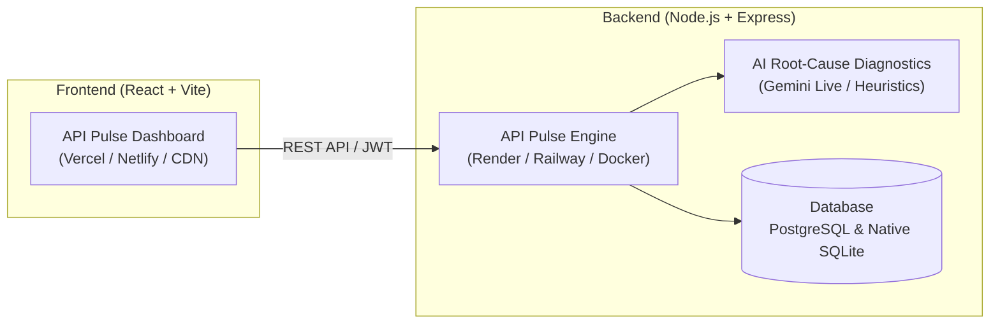

# 🚀 API Pulse Deployment Guide

This guide covers deployment options for **API Pulse** (Frontend + Backend).

---

## 🏗️ Architecture Overview



---

## ⚡ Option 1: Modern Dual Cloud (Recommended — 100% Free)

Best for quick cloud setup with continuous deployments on Git push.

### Step 1: Push Project to GitHub
Open your terminal in `C:\API_PULSE` and run:
```bash
git init
git add .
git commit -m "feat: complete API Pulse platform with strict auth and AI remediation"
git branch -M main
git remote add origin https://github.com/<YOUR_GITHUB_USERNAME>/api-pulse.git
git push -u origin main
```

---

### Step 2: Deploy Backend to Render (Free)
1. Go to [Render.com](https://render.com) and sign in.
2. Click **New +** ➔ **Web Service**.
3. Connect your GitHub repository `api-pulse`.
4. Configure the settings:
   - **Name:** `api-pulse-backend`
   - **Root Directory:** `backend`
   - **Environment:** `Node`
   - **Build Command:** `npm install && npm run build`
   - **Start Command:** `npm run start`
   - **Plan:** Free
5. Under **Environment Variables**, add:
   | Key | Value | Notes |
   |---|---|---|
   | `NODE_ENV` | `production` | Enables production optimizations |
   | `PORT` | `8000` | Port for Express listener |
   | `JWT_SECRET` | *(Generate a secure random string)* | E.g. `apipulse_secret_key_prod_2026` |
   | `GEMINI_API_KEY` | *(Optional)* | Your Gemini API Key for Live AI analysis |
   | `DATABASE_URL` | *(Optional)* | PostgreSQL connection string (or leaves SQLite active) |
6. Click **Deploy Web Service**.
7. Copy your backend URL (e.g. `https://api-pulse-backend.onrender.com`).

---

### Step 3: Deploy Frontend to Vercel (Free)
1. Go to [Vercel.com](https://vercel.com) and sign in with GitHub.
2. Click **Add New...** ➔ **Project**.
3. Import your `api-pulse` repository.
4. Configure the build settings:
   - **Framework Preset:** `Vite`
   - **Root Directory:** `frontend`
5. Under **Environment Variables**, add:
   | Key | Value |
   |---|---|
   | `VITE_API_URL` | `https://api-pulse-backend.onrender.com/api/v1` |
   *(Replace with your actual Render backend URL from Step 2)*
6. Click **Deploy**.
7. Your frontend is live! (e.g. `https://api-pulse.vercel.app`).

---

## 🐳 Option 2: Unified Docker All-In-One (Single URL for Mentors)

Both frontend and backend run in a single container. Express serves both the REST API and the React SPA on the exact same domain (zero CORS configuration required).

### Local Docker Testing
```bash
docker build -t api-pulse .
docker run -p 8000:8000 -v api_pulse_data:/app/backend/data api-pulse
```
Then visit: `http://localhost:8000` in your browser.

### Deploying the Dockerfile to Railway / Koyeb / Render:
1. Create a new service on **Railway** or **Render**.
2. Select **Deploy from Dockerfile**.
3. The Dockerfile automatically:
   - Compiles the React Vite frontend
   - Compiles the Express TypeScript backend
   - Mounts the static frontend on `/` and API routes on `/api/v1`
   - Launches on port `8000` (or `$PORT` assigned by cloud host)

---

## 🗄️ Database Options

1. **Native SQLite (Default — Zero Config):**
   - Automatically stores all users, endpoints, logs, and alerts in `backend/data/apipulse.db`.
   - No external database setup required.
2. **Managed PostgreSQL (Enterprise / Production):**
   - Provide a `DATABASE_URL` from [Neon](https://neon.tech), [Supabase](https://supabase.com), or [Render Postgres].
   - API Pulse will automatically execute the schema migrations from `backend/src/db/schema.sql` on startup!

---

## 📋 Pre-Flight Verification Checklist Before Presentation

- [x] Strict Authentication enabled (no fake demo bypasses; users must register to log in).
- [x] Zero mock data fallback (clean database persistence in SQL tables).
- [x] Automated Issue Detection ($\ge 400$, 500, timeout triggers alerts).
- [x] Instant redirection to `/alerts?endpointId=...&aiFix=true`.
- [x] AI Incident Diagnosis & Resolution Drawer with copyable code fixes.
- [x] Live in-drawer re-test button verifying recovery.
- [x] Frontend build & Backend build passing with 0 TypeScript errors.

